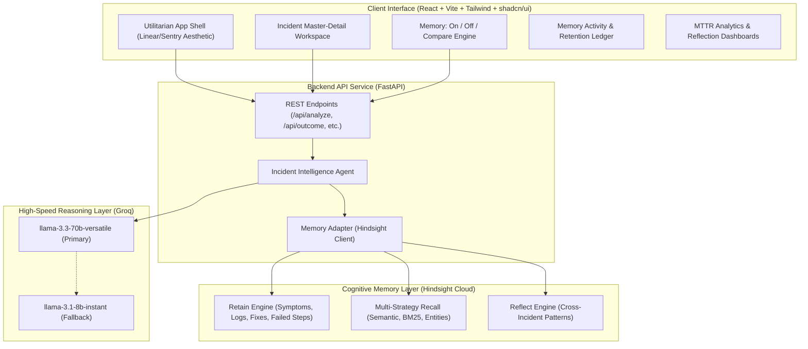

# Recur

> **Autonomous Incident Memory for On-Call Engineering Teams**  
> When production breaks, Recur recalls how similar past incidents were diagnosed and fixed—including which fixes **FAILED**—and learns from every resolution so that on-call MTTR continuously drops over time.

---

## ⚡ Overview

On-call incident response suffers from an acute organizational memory deficit:
1. **The 3 AM Brain Drain**: The senior engineer who diagnosed and resolved a tricky outage six months ago is asleep or has left the company.
2. **Repetition of Fatal Mistakes**: Teams repeatedly retry fixes that failed in the past (e.g. restarting saturated pods, which triggers a thundering herd that crashes the primary database).
3. **Stateless AI Hallucination**: Generic chatbots offer broad, generic suggestions with zero awareness of your specific infrastructure topologies, past root causes, or runbook precedents.

**Recur solves this by embedding an active semantic memory layer directly into on-call incident triage.** Recur uses **Hindsight Cloud** for structured memory extraction, multi-strategy semantic recall, and pattern synthesis, combined with **Groq LLM** (`llama-3.3-70b-versatile`) for rapid sub-second diagnosis.

---

## 🏗️ Architecture



---

## 🧠 How Memory Works

Recur's memory system operates on three foundational primitives powered by Hindsight:

### 1. Retain (`retain_incident`)
When an incident is resolved, Recur retains a structured post-mortem memory package into Hindsight Cloud:
- **Alert & Symptoms**: The initial pager alert and high-level behavioral anomalies.
- **Representative Logs**: 8–15 lines of raw stack traces, error codes, and saturation indicators.
- **Identified Root Cause**: The technical defect that caused the failure.
- **Successful Fix Steps**: The verified sequence of steps that restored service.
- **Failed Attempts (Crucial)**: Explicit actions that were attempted and **failed**, along with the technical rationale (e.g. *"Restarting payments-api pods caused 500 new connection handshakes simultaneously, causing Postgres CPU to spike to 100%"*).
- **Resolution Metrics**: Elapsed time to resolve (MTTR), service name, runbook links, and responder identity.

### 2. Recall (`recall_similar`)
When a new alert fires:
- Recur extracts core error tokens and queries Hindsight using hybrid multi-strategy retrieval (semantic vector search, BM25 keyword matching, entity graph traversal, and temporal recency).
- Recur returns factual units rather than loose document chunks, citing exact past incident IDs (`INC-001`, `INC-014`).
- Grounded citations feed into Groq's structured JSON analysis engine. If no relevant past memories exist, Recur explicitly declares `"no similar incidents found"` and restrains diagnostic confidence.

### 3. Reflect (`reflect_patterns`)
- Beyond isolated incident retrieval, Recur triggers Hindsight's reasoning layer across the entire memory bank.
- Synthesizes systemic failure modes:
  1. Identifies recurring root-cause families across services (e.g. pool exhaustion, noeviction policies).
  2. Flags antipatterns and hazardous fixes that engineers must systematically avoid.
  3. Recommends permanent architectural guardrails (e.g. connection rate caps, mandatory LRU eviction).

### 4. How the Agent Improves (The Learning Curve)
Across our benchmark of 30 historical incidents spanning 7 recurring root-cause families, Recur demonstrates a genuine learning curve:
- **First occurrence of a failure family**: Average MTTR is ~90 minutes (unfamiliar symptoms, exploratory troubleshooting).
- **Subsequent recurrences**: MTTR falls rapidly to **~12 minutes** as Recur cites previous matches, provides immediate actionable fixes, and flags dangerous trial-and-error steps to avoid.

---

## ⚡ The Innovation Edge: Side-by-Side Comparison

Recur features an integrated **"Memory: On / Off / Compare"** engine on the incident analysis workspace:
- **Left Column ("Without Memory")**: Shows how standard AI models or junior responders operate without institutional context: generic recommendations, trial-and-error steps, estimated ~90 min resolution time, and low confidence (35–45%).
- **Right Column ("With Memory")**: Shows Recur's memory-grounded diagnosis: cites exact past incidents (e.g. `INC-014` at 91% similarity), delivers targeted fixes, highlights previously failed steps in an **Avoid** panel, achieves ~14 min estimated MTTR, and delivers 90%+ confidence.
- **Summary Difference Bar**: Quantifies the exact time saved and confidence gained for on-call engineers.

---

## 🚀 Quick Start

### Prerequisites
- Python 3.11+
- Node.js 18+ and npm
- Groq API Key
- Hindsight Cloud API Key

### 1. Clone & Configure Environment
```bash
git clone https://github.com/your-org/recur.git
cd recur
cp .env.example .env
```

Edit `.env`:
```env
GROQ_API_KEY=gsk_your_groq_api_key_here
HINDSIGHT_API_KEY=hsk_your_hindsight_api_key_here
HINDSIGHT_BASE_URL=https://api.hindsight.vectorize.io
```

### 2. Backend Setup
```bash
# Install Python dependencies
pip install fastapi uvicorn pydantic python-dotenv groq hindsight-client httpx requests

# Run tests to verify memory & API integrity
python backend/tests/test_memory.py
python backend/tests/test_api.py
python backend/tests/test_agent_edge_cases.py

# Start FastAPI backend
uvicorn backend.app.main:app --host 127.0.0.1 --port 8000 --reload
```

### 3. Frontend Setup
```bash
cd frontend
npm install
npm run build
npm run dev
```

Open [http://localhost:8000](http://localhost:8000) in your browser.

---

## 📊 Environment Variables

| Variable | Description | Default |
|---|---|---|
| `GROQ_API_KEY` | Groq API Key for high-speed LLM reasoning | Required |
| `HINDSIGHT_API_KEY` | Hindsight Cloud API Key for semantic memory | Required |
| `HINDSIGHT_BASE_URL` | Hindsight API server endpoint | `https://api.hindsight.vectorize.io` |
| `HINDSIGHT_BANK_ID` | Memory bank namespace | `recur_production_incidents` |

---

## 🗺️ Roadmap

- [x] **Phase 1: Memory Foundation** – Hindsight Cloud integration (`retain`, `recall`, `reflect`), activity logging, and verifiable test spikes.
- [x] **Phase 2: Intelligent Reasoning** – Structured JSON-mode Groq analysis with Pydantic validation, 3-stage retries, and fallback models.
- [x] **Phase 3: Utilitarian Workspace** – Master-detail UI, Linear-inspired design system, LogViewer, and side-by-side Memory Comparison.
- [x] **Phase 4: Analytics & Learning Curve** – Recharts MTTR line charts, root-cause distribution bars, and Hindsight Reflect pattern synthesis.
- [ ] **Phase 5: Automated Slack & PagerDuty Webhooks** – Ingesting live alerts directly from PagerDuty and posting diagnostic cards into incident Slack channels.
- [ ] **Phase 6: Multi-Tenant Enterprise Banks** – Role-based access control and namespace segregation across autonomous engineering divisions.
